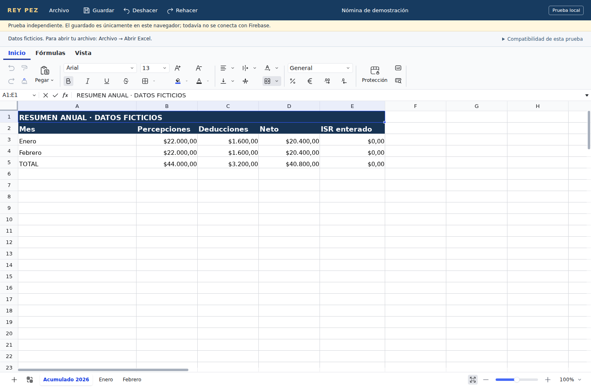

# Prueba aislada de editor de Nómina

No forma parte de la app publicada. No usa Firebase, credenciales, servidores de conversión ni datos privados incluidos en el código.

Editor elegido para evaluación: Univer Sheets 1.3.1, núcleo Apache-2.0, español. Solo se usa el preset de código abierto, sin módulos Pro. ExcelJS lee el archivo y JSZip conserva el contenedor XLSX original en la descarga limitada de prueba. No se usa el servicio oficial de conversión.

Desde esta carpeta:

```bash
npm ci
npm run iniciar
```

Abrir la URL local mostrada por Vite. Primero aparecen datos ficticios. Se puede abrir un XLSX local de hasta 10 MB.

## Qué se prueba

- Cinta de herramientas de dos filas, con pestañas Inicio, Fórmulas y Vista, barra de fórmulas y hojas inferiores. Menú Archivo para abrir, guardar, reabrir y descargar. Accesos rápidos Guardar, Deshacer y Rehacer, más Ctrl+S para guardar localmente.
- Editor de celdas y fórmulas con pestañas y herramientas en español.
- Lectura de las hojas, fórmulas internas, formatos básicos, anchos y combinaciones del archivo.
- Guardado completo del estado del editor y archivo de origen en IndexedDB. Se conservan tres versiones; el botón reabre la última. No es un respaldo en la nube ni sobrevive a borrar los datos del navegador.
- Exportación de cambios en valores y fórmulas sobre el ZIP original. Mantiene los componentes no editados, incluidos los vínculos externos y sus valores originales. Solicita recálculo en Excel. Los resultados guardados de fórmulas dependientes pueden estar desactualizados hasta ese recálculo.
- Las fórmulas externas se muestran con su último valor, sin ejecutarlas. Al cambiar esa celda se sustituye su fórmula externa por el nuevo contenido en la copia exportada.
- Para no descargar un archivo que descarte cambios, la exportación rechaza modificaciones de formato, filas/columnas, fusiones y pestañas. Esas modificaciones sí quedan en el guardado completo del editor.

## Pendiente antes de integrar

La descarga completa de estructura y formatos, traducción de estilos avanzados y colores de tema, comprobación de todos los resultados de fórmulas del libro real, manejo de nombres definidos, validaciones y otros objetos, recuperación seleccionable de versiones, permisos y almacenamiento privado en nube. No se ofrece equivalencia con Excel ni un porcentaje de compatibilidad.

El estado del editor de un libro grande no debe guardarse a ciegas en un solo documento de Firestore (límite de tamaño). La prueba no altera colecciones ni reglas actuales. Hay que medir tamaño, definir almacenamiento por partes y escrituras atómicas/versionadas antes de integrar.

Documentación consultada:

- https://docs.univer.ai/guides/sheets/getting-started/installation
- https://docs.univer.ai/guides/sheets/model/cell-data
- https://docs.univer.ai/guides/sheets/model/workbook-data
- https://docs.univer.ai/guides/sheets/features/import-export
- https://github.com/dream-num/univer/blob/dev/LICENSE

No publicar archivos de nómina reales ni datos del navegador. La prueba debe revisarse con quien prepara la nómina antes de integrarse.

## Resultado de la evaluación del 30/10/2026

Se comprobó el recálculo de una fórmula interna tras editar una cantidad, la edición de una fórmula, el guardado y reapertura después de recargar la página, la descarga con preservación de moneda y fórmulas, y el rechazo de cambios de formato que esta exportación limitada no puede representar.

La revisión de la interfaz también comprobó Deshacer/Rehacer con los botones, guardar con Ctrl+S, descargar y reabrir desde Archivo, cerrar el menú con Escape y que su panel cabe en un ancho de 390 px. Se normalizan objetos vacíos de estilo al comparar formatos, porque el editor puede eliminarlos al deshacer sin que cambie el aspecto de la celda.

Auditoría de dependencias de la prueba: cero vulnerabilidades reportadas. La aplicación existente conserva sus 72 pruebas de lógica y 56 recorridos de navegador aprobados. No se modificó ni publicó la aplicación.

Las pruebas publicadas usan únicamente libros sintéticos. No incluir en el repositorio resultados, conteos, referencias, nombres, tamaños ni otros metadatos derivados de archivos privados de nómina.


